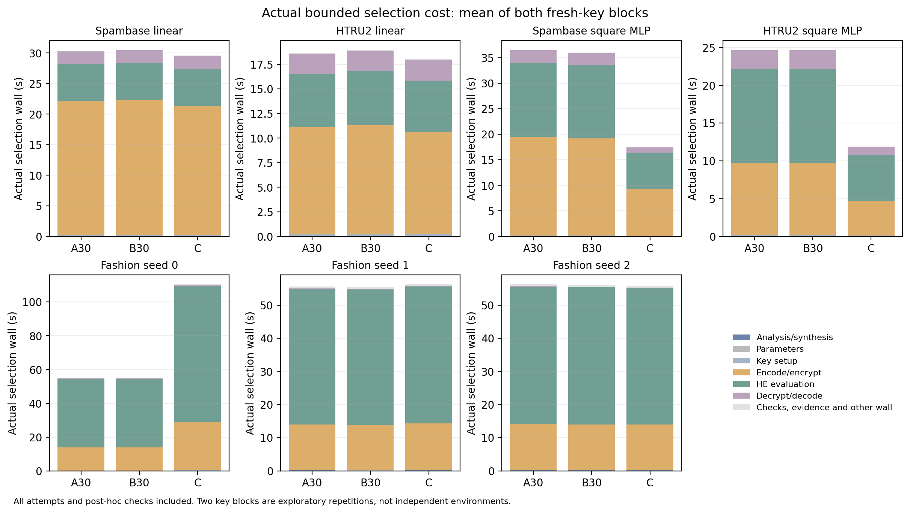
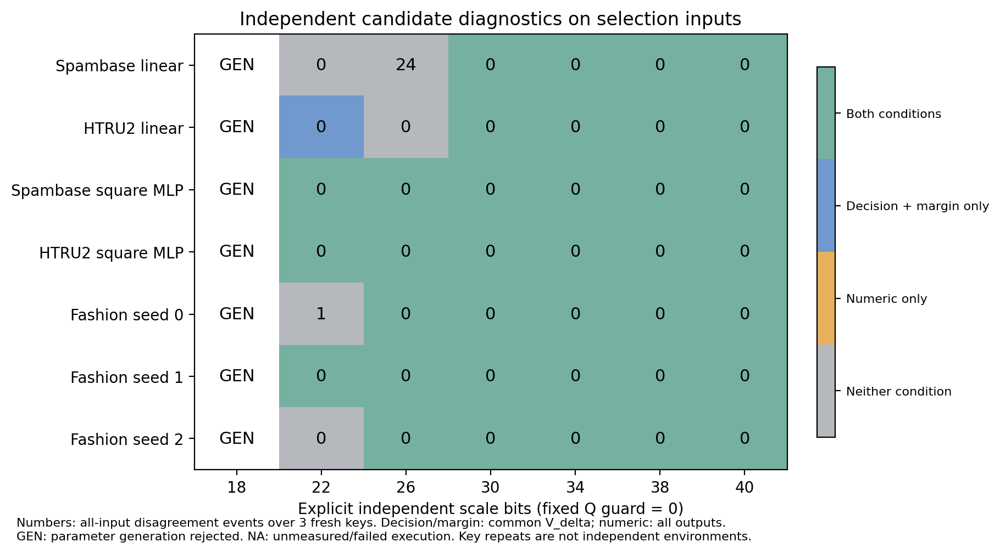
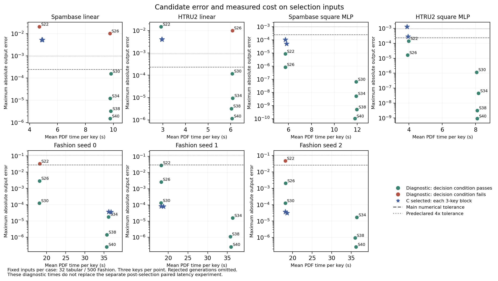

# CKKS 판정 조건과 선택 절차의 기여 검증

**판정 조건을 선택에 넣는 추가 효과는 주 A–B 비교에서 미관측이다.** A30과 B30은 14개 사례–선택블록에서 같은 구성을 골랐고 0개에서 달랐다. 독립 후보 지도에서 조건별 수용이 다른 후보는 1개지만, 후보 집합 차이와 실제 제한 선택의 개선은 별개다.

**제안 C가 단순 판정 선택 B보다 적은 후보 평가를 필요로 한다는 효과는 미관측이다.** B30보다 적게 평가한 블록은 0, 같은 블록은 10, 더 평가한 블록은 4개다. C의 선택·추론 비용 효과는 사례와 정확성 요구에 따라 아래 표로 분리하며, 구성 변경 자체를 개선으로 세지 않는다.

**독립 수치 기준의 판정 한계에 대한 판정은 지지됨이며, 확인한 허용값 범위에 한정한다.** 동일 평가 자료에서 주 최대오차 조건을 통과하면서 전체 판정 불일치가 나온 독립 진단 후보는 0, 별도 감사 구성은 0개다. 사전 고정한 허용값 민감도에서 수치 통과와 판정 불일치가 함께 나온 후보–허용값 조합은 1개다. 이것은 실제 A/B 출발점이나 허용값을 바꿔 다시 선택한 결과가 아니다. 스트레스의 주 조건에서 같은 유형은 0개로 별도 집계하며 일반 발생률에 합치지 않는다.

A–B는 수용 조건 교체의 효과, B–C는 같은 판정 목적에서 합성·조정 절차의 효과이다. 아래의 정확성·적용 범위·비용 결과를 함께 판단하며, 현재 범위의 무차이는 모든 조건에서 기여가 없다는 증명이 아니다.

**선택·일반 감사의 통과가 새 입력 전체의 판정 보장은 아니다.** 외부 공통 스트레스에서 C는 적용 영역 판정 변화 1회와 오차 조건 위반 6회가 있었다. 합성 입력의 실제 정답·고객 타당성은 미확정이지만, 고정 모델의 평문 판정과의 불일치는 관측 사실이다. 아래의 동일 입력 비교와 내부 스트레스를 함께 보고한다.

## 질문별 판단과 실행 범위

| 판별 항목 | 판정 | 근거와 한정 |
| --- | --- | --- |
| 독립 수치 기준의 판정 한계 | 지지됨 | 주 기준의 독립 진단 0개·일반 감사 0개, 사전 민감도 1개 후보–허용값 조합. 민감도 사례는 실제 A30 선택 실패가 아니다. |
| 판정 관련 수용 조건의 추가 효과 | 미관측 | 실제 A30/B30 선택은 14/14 블록에서 동일. 후보 지도에서 특정 후보를 배제하는 효과와 실제 선택 개선을 분리한다. |
| 단순 판정 선택 대비 제안 합성·조정 절차의 추가 효과 | 지지됨 | 사례별 관측 선택 비용에 한정. C 후보 수 감소 0, 동일 10, 증가 4블록. 두 블록 모두 비용 감소한 사례 5, 증가한 사례 2. 통계적 우월성·모든 시작점의 개선은 판단하지 않는다. |
| 동일 판정 목적에서의 선택·추론 비용 절충 | 지지됨 | 같은 B/C 판정 목적의 실제 선택 비용과 새 대응 추론 시간을 사례별 공개한다. 수치 요구가 다르거나 비용이 증가한 결과를 함께 보고하며, 개선 방향은 아래 대응 표로 한정한다. |
| 외부 문제 사례에 대한 적용 범위 | 판단 불가 | 공개 절차 Bank 모델의 일반·합성 입력에서 공식 native 판정 이탈 입력은 0개, 그중 적용 영역에서 C 판정·오차 조건을 모두 통과한 입력은 0개. 원래 문제 해결을 판단할 자료와 단순 실행 완료를 구분한다. C는 합성 스트레스 적용 영역에서 판정 변화 1, 오차 조건 위반 6키 사건으로 불리했다. 원래 가중치·발견 corpus 재현도 아니다. |

주 비교 B30–C의 선택 구성은 0개 사례–선택블록에서 같고 14개에서 달랐다. 동일 구성 alias는 같은 감사 자료를 공유하므로 역할을 늘려 분모를 부풀리지 않는다.

독립 후보 지도에서 주 수치 조건을 통과하면서 전체 입력의 판정 불일치가 발생한 후보는 0개이며, 그중 적용 영역 불일치가 있는 후보는 0개다. 이 지도는 실제 제한 선택과 별도인 사후 조건 진단이다. 관측되지 않은 유형을 만들기 위해 허용값·모델·입력을 조정하지 않았다.

A–B의 수용 조건 효과와 B–C의 선택 절차 효과를 합치지 않는다. 표형 네 모델은 주 수치 조건 자체가 적용 영역 오차 조건을 포함한다. 선택 비용 차이가 있어도 판정 불일치 감소의 증거로 대체하지 않는다. 두 키 블록의 시간 차이는 관측값이며 통계적 우월성·동등성 판단은 아니다.

상태: **COMPLETED_EXPLORATORY**. 실제 선택 70/70, 독립 후보 진단 49/49개 규격 중 CKKS 실행 42개, 선택 구성별 전체 감사 22/22, 대응 시간 작업 45/45, 내부 스트레스 22/22. 진단의 나머지 7개는 S18 생성 탈락으로 보존했다. command 비정상 종료 0건이다. 생성 탈락과 실행 실패 및 과학적 수용 실패를 구분한다.

구현 함수·호출 경로·독립 생성 규칙·수치 조건·보존 범위는 [METHOD_AND_SCOPE_KO.md](METHOD_AND_SCOPE_KO.md), 실행 전 고정 규격은 [FG_CONTRIB_V1.json](../../../protocols/FG_CONTRIB_V1.json)에 연결했다.

## 실제 선택 결과

표의 S는 log2(scale), Q는 Q 소수 개수, N은 log2(다항식 차수)이다. 예를 들어 N13은 실제 차수 8192이다. 아래 비용은 두 블록의 실제 선택 프로세스 호출 wall time 평균(초)이다. 구성·평가 횟수가 블록별로 다르면 `/`로 모두 표시한다. 세부 70행과 비용 원인은 [SELECTION_RUNS.csv](SELECTION_RUNS.csv), 후보별 교차 조건은 [TRIAL_METRICS.csv](TRIAL_METRICS.csv)에 있다.

| 사례 | A 구성 | A 후보 수 | A 초 | B 구성 | B 후보 수 | B 초 | C 구성 | C 후보 수 | C 초 |
| --- | --- | --- | --- | --- | --- | --- | --- | --- | --- |
| Spambase 선형+3차 | S30/Q7/N14 | 1/1 | 30.358 | S30/Q7/N14 | 1/1 | 30.511 | S24/Q7/N13 | 2/2 | 29.598 |
| HTRU2 선형+3차 | S30/Q7/N14 | 1/1 | 18.654 | S30/Q7/N14 | 1/1 | 18.978 | S24/Q7/N13 | 2/2 | 18.063 |
| Spambase MLP | S30/Q6/N14 | 1/1 | 36.538 | S30/Q6/N14 | 1/1 | 36.035 | S20/Q6/N13 | 1/1 | 17.480 |
| HTRU2 MLP | S30/Q6/N14 | 1/1 | 24.687 | S30/Q6/N14 | 1/1 | 24.689 | S20/Q6/N13 | 1/1 | 11.910 |
| Fashion seed0 | S30/Q5/N13 | 1/1 | 55.282 | S30/Q5/N13 | 1/1 | 55.279 | S33/Q5/N14 | 1/1 | 110.443 |
| Fashion seed1 | S30/Q5/N13 | 1/1 | 55.592 | S30/Q5/N13 | 1/1 | 55.430 | S31/Q5/N13 | 1/1 | 56.260 |
| Fashion seed2 | S30/Q5/N13 | 1/1 | 56.279 | S30/Q5/N13 | 1/1 | 56.091 | S32/Q5/N13 | 1/1 | 55.797 |

보수적 A40/B40도 같은 두 블록·4후보 상한으로 실행했고 14/14개 사례–블록에서 같은 구성을 선택했다. 원시 선택 표에 모두 보존했다. 유한 최속 후보를 실제 C 산출물로 대체하지 않았다.

Fashion seed0에서 C는 선언 QP 비트 합 218로 동결된 N=8192의 한도 214를 넘어 N=16384를 선택했다. A30/B30의 QP 합은 200으로 N=8192에서 수용됐다. 이 구조적 비용 증가를 없애려고 C나 보안 한도를 조정하지 않았다. 실제 비용 크기는 아래의 새 대응 시간에서 판단한다.

| 사례 | 보수적 A40/B40 구성 | A40 선택 초 | B40 선택 초 | C/B30 선택 비용 각 블록 | C/B40 선택 비용 각 블록 |
| --- | --- | --- | --- | --- | --- |
| Spambase 선형+3차 | S40/Q7/N14 | 30.736 | 30.915 | 0.974, 0.966 | 0.957, 0.957 |
| HTRU2 선형+3차 | S40/Q7/N14 | 18.755 | 18.732 | 0.969, 0.936 | 0.971, 0.958 |
| Spambase MLP | S40/Q6/N14 | 36.376 | 36.836 | 0.479, 0.491 | 0.468, 0.481 |
| HTRU2 MLP | S40/Q6/N14 | 24.853 | 24.820 | 0.482, 0.483 | 0.480, 0.479 |
| Fashion seed0 | S40/Q5/N14 | 110.651 | 110.277 | 1.991, 2.004 | 0.999, 1.004 |
| Fashion seed1 | S40/Q5/N14 | 111.422 | 111.734 | 1.026, 1.004 | 0.507, 0.500 |
| Fashion seed2 | S40/Q5/N14 | 111.435 | 111.525 | 0.991, 0.999 | 0.498, 0.502 |

선택 비용 비율은 C/B이며 1보다 작으면 C의 관측 선택 비용이 작다. 아래 추론 표의 comparator/C 비율과 분자·분모가 다르므로 혼동하지 않는다.

## 별도 입력 감사

아래 각 행의 구성은 해당 역할의 두 블록에서 실제 선택된 구성이다. 키 문맥은 구성·배치별로 새로 생성했다. 공통 입력 분모와 적용 영역은 평문 모델로 동일하게 정한다. 시험 입력은 이미 노출된 자료이며 새 키가 새 입력 확증을 뜻하지 않는다.

전체 계획은 고유 모델–입력 쌍 31,024개다. 현재 구성별 입력 평가 합계 93,328개, 키 합산 관측 279,984개, 실제 구성·배치별 감사 키 문맥 579개를 기록했다. 세 Fashion 모델이 같은 시험 자료를 공유하므로 이 수들을 독립 데이터 수나 독립 환경 수로 바꾸지 않는다.

| 사례 | 역할 alias | 구성 | 전체 입력 | 적용 | 경계 | 키 합산 관측 | 적용 판정 변화 | 적용 오차 위반 | 경계 판정 변화 | 최대오차 | 수치 사후 통과 | 제안 사후 통과 | 평문 정답률 % |
| --- | --- | --- | --- | --- | --- | --- | --- | --- | --- | --- | --- | --- | --- |
| Spambase 선형+3차 | A30/B30 | S30/Q7/N14 | 256/256 | 235 | 21 | 768 | 0 | 0 | 0 | 0.0001514013 | True | True | 91.80 |
| Spambase 선형+3차 | C | S24/Q7/N13 | 256/256 | 235 | 21 | 768 | 0 | 0 | 3 | 0.005169058 | False | True | 91.80 |
| Spambase 선형+3차 | A40/B40 | S40/Q7/N14 | 256/256 | 235 | 21 | 768 | 0 | 0 | 0 | 1.487648e-06 | True | True | 91.80 |
| Spambase 선형+3차 | legacy_fixed_numeric | S32/Q8/N14 | 256/256 | 235 | 21 | 768 | 0 | 0 | 0 | 0.0001118654 | True | True | 91.80 |
| HTRU2 선형+3차 | A30/B30 | S30/Q7/N14 | 256/256 | 256 | 0 | 768 | 0 | 0 | 0 | 0.0002216045 | True | True | 98.05 |
| HTRU2 선형+3차 | C | S24/Q7/N13 | 256/256 | 256 | 0 | 768 | 0 | 0 | 0 | 0.007503858 | False | True | 98.05 |
| HTRU2 선형+3차 | A40/B40 | S40/Q7/N14 | 256/256 | 256 | 0 | 768 | 0 | 0 | 0 | 2.166904e-06 | True | True | 98.05 |
| Spambase MLP | A30/B30 | S30/Q6/N14 | 256/256 | 75 | 181 | 768 | 0 | 0 | 0 | 6.777846e-08 | True | True | 90.62 |
| Spambase MLP | C | S20/Q6/N13 | 256/256 | 75 | 181 | 768 | 0 | 0 | 0 | 8.232083e-05 | True | True | 90.62 |
| Spambase MLP | A40/B40 | S40/Q6/N14 | 256/256 | 75 | 181 | 768 | 0 | 0 | 0 | 6.756851e-11 | True | True | 90.62 |
| HTRU2 MLP | A30/B30 | S30/Q6/N14 | 256/256 | 254 | 2 | 768 | 0 | 0 | 0 | 1.889179e-06 | True | True | 97.66 |
| HTRU2 MLP | C | S20/Q6/N13 | 256/256 | 254 | 2 | 768 | 0 | 0 | 0 | 0.0006802959 | False | True | 97.66 |
| HTRU2 MLP | A40/B40 | S40/Q6/N14 | 256/256 | 254 | 2 | 768 | 0 | 0 | 0 | 1.270062e-09 | True | True | 97.66 |
| Fashion seed0 | A30/B30 | S30/Q5/N13 | 10000/10000 | 9999 | 1 | 30000 | 0 | 0 | 0 | 0.0002055012 | True | True | 87.66 |
| Fashion seed0 | C | S33/Q5/N14 | 10000/10000 | 9999 | 1 | 30000 | 0 | 0 | 0 | 5.382347e-05 | True | True | 87.66 |
| Fashion seed0 | A40/B40 | S40/Q5/N14 | 10000/10000 | 9999 | 1 | 30000 | 0 | 0 | 0 | 4.418535e-07 | True | True | 87.66 |
| Fashion seed1 | A30/B30 | S30/Q5/N13 | 10000/10000 | 9999 | 1 | 30000 | 0 | 0 | 0 | 0.0001917056 | True | True | 87.62 |
| Fashion seed1 | C | S31/Q5/N13 | 10000/10000 | 9999 | 1 | 30000 | 0 | 0 | 0 | 8.558772e-05 | True | True | 87.62 |
| Fashion seed1 | A40/B40 | S40/Q5/N14 | 10000/10000 | 9999 | 1 | 30000 | 0 | 0 | 0 | 3.417615e-07 | True | True | 87.62 |
| Fashion seed2 | A30/B30 | S30/Q5/N13 | 10000/10000 | 10000 | 0 | 30000 | 0 | 0 | 0 | 0.000191407 | True | True | 87.88 |
| Fashion seed2 | C | S32/Q5/N13 | 10000/10000 | 10000 | 0 | 30000 | 0 | 0 | 0 | 6.346142e-05 | True | True | 87.88 |
| Fashion seed2 | A40/B40 | S40/Q5/N14 | 10000/10000 | 10000 | 0 | 30000 | 0 | 0 | 0 | 3.993635e-07 | True | True | 87.88 |

고유 위반 입력 수, 전체 RMSE, 배치 수와 미완료 여부는 [AUDIT.csv](AUDIT.csv), 입력별 사건은 [INPUT_OBSERVATIONS.csv.gz](INPUT_OBSERVATIONS.csv.gz)에 있다. 판정 보존과 보수적 충분조건 위반을 별개로 집계했다. 미평가를 0으로 채우지 않았다.

이번 일반 감사에서 C만의 판정 개선은 관측되지 않았다. Spambase 선형의 경계 입력 `3455`는 C에서 세 키 모두 판정이 바뀌었고 A30/B30·A40/B40·기존 S32에서는 유지됐다. 이 입력의 평문 마진은 약 0.0000120669로 적용 영역 밖이다. 적용 영역 0건이라는 결과로 이 전체 입력의 불리한 관측을 숨기지 않는다. 해당 입력과 키별 원시 경로는 [INPUT_TYPES.csv](INPUT_TYPES.csv)에 있다.

Spambase MLP의 적용 영역은 75/256개(약 29.3%)다. 나머지 181개에서 관측 판정이 같아도 모두 보호 범위에 들어간다고 표현하지 않는다. Fashion seed0/seed1은 각각 9,999개 적용·1개 경계, seed2는 10,000개 적용이며, 이 일반 감사에서는 모든 선택 구성의 전체 판정이 유지됐다. 이 결과는 이미 노출된 시험 입력과 측정한 키에 한정한다.

표형 네 모델의 개발 최대오차 기준은 0.000228–0.000243 범위로 `rho × delta = 0.0005`보다 작다. 이 수치 기준을 통과하는 적용 영역 입력은 원래 마진 오차 조건도 통과한다. 반대로 큰 마진에서는 제안 조건이 더 큰 절대오차를 허용한다. C가 수치 기준을 통과하지 않으면서 더 빠른 경우는 정확성 요구의 절충이며 같은 수치 정확성의 우월성이 아니다.

## 선택 후 대응 시간

최종 PDF 정의의 인코딩·암호화 + HE + 복호화·디코딩 합을 새로 측정했다. 키 준비는 모든 대조군에서 같은 방식으로 별도 기록했다. 다음 비율은 comparator/C이고 1보다 크면 그 관측에서 C가 더 빠르다. 입력·회차 대응 후 각 키 블록에서 기하평균하고 세 블록을 같은 비중으로 요약한다. 경계·key·slot을 독립 환경 표본으로 보지 않으며 신뢰구간이나 동등성을 선언하지 않는다.

| 사례 | C/기준 | 대조 구성 | C 평균 ms | 대조 평균 ms | 대조/기준 비율 | 각 키 블록 비율 | 단위 |
| --- | --- | --- | --- | --- | --- | --- | --- |
| Spambase 선형+3차 | S24/Q7/N13 | S30/Q7/N14 | 147.161 | 306.289 | 2.082 | 2.090, 2.077, 2.078 | one fixed input |
| Spambase 선형+3차 | S24/Q7/N13 | S40/Q7/N14 | 147.109 | 307.516 | 2.091 | 2.092, 2.088, 2.093 | one fixed input |
| Spambase 선형+3차 | S24/Q7/N13 | S32/Q8/N14 | 146.979 | 360.845 | 2.455 | 2.458, 2.458, 2.449 | one fixed input |
| HTRU2 선형+3차 | S24/Q7/N13 | S30/Q7/N14 | 90.640 | 187.630 | 2.070 | 2.060, 2.080, 2.072 | one fixed input |
| HTRU2 선형+3차 | S24/Q7/N13 | S40/Q7/N14 | 90.706 | 188.427 | 2.078 | 2.068, 2.085, 2.079 | one fixed input |
| Spambase MLP | S20/Q6/N13 | S30/Q6/N14 | 174.603 | 372.061 | 2.131 | 2.132, 2.131, 2.129 | one fixed input |
| Spambase MLP | S20/Q6/N13 | S40/Q6/N14 | 174.991 | 373.350 | 2.134 | 2.131, 2.131, 2.139 | one fixed input |
| HTRU2 MLP | S20/Q6/N13 | S30/Q6/N14 | 118.878 | 252.156 | 2.121 | 2.131, 2.113, 2.120 | one fixed input |
| HTRU2 MLP | S20/Q6/N13 | S40/Q6/N14 | 119.370 | 254.536 | 2.133 | 2.129, 2.134, 2.136 | one fixed input |
| Fashion seed0 | S33/Q5/N14 | S30/Q5/N13 | 35910.638 | 17710.882 | 0.493 | 0.493, 0.493, 0.494 | one fixed input batch |
| Fashion seed0 | S33/Q5/N14 | S40/Q5/N14 | 36024.608 | 36056.223 | 1.001 | 1.002, 1.000, 1.000 | one fixed input batch |
| Fashion seed1 | S31/Q5/N13 | S30/Q5/N13 | 17919.831 | 17905.902 | 0.999 | 1.000, 0.998, 1.000 | one fixed input batch |
| Fashion seed1 | S31/Q5/N13 | S40/Q5/N14 | 17831.362 | 35991.778 | 2.018 | 2.023, 2.016, 2.017 | one fixed input batch |
| Fashion seed2 | S32/Q5/N13 | S30/Q5/N13 | 17967.849 | 17917.162 | 0.997 | 0.990, 0.999, 1.003 | one fixed input batch |
| Fashion seed2 | S32/Q5/N13 | S40/Q5/N14 | 17857.390 | 36114.980 | 2.022 | 2.028, 2.021, 2.018 | one fixed input batch |

절대 시간은 키별 측정 평균을 같은 비중으로 평균한 값이다. 비율은 대응 관측의 기하평균이므로 이 두 평균의 단순 나눗셈과 같지 않을 수 있다. [분리된 역할·단계 비용과 키 준비](TIMING_ARMS.csv), [키별 요약](TIMING_BLOCKS.csv), [대응 원시 계측](TIMING_RECORDS.csv). 표형은 입력별, Fashion은 고정 20입력 배치별 시간이다. 서로 다른 단위를 하나의 전체 지연으로 합치지 않는다. 네트워크·운영 큐는 미측정이다.

| 사례 | 경로 | 키·파라미터 준비 ms | 인코딩·암호화 ms | HE ms | 복호화·디코딩 ms | PDF 합 ms |
| --- | --- | --- | --- | --- | --- | --- |
| Spambase 선형+3차 | C | 43.035 | 106.522 | 29.535 | 11.104 | 147.161 |
| Spambase 선형+3차 | A30/B30 | 77.813 | 222.806 | 62.078 | 21.404 | 306.289 |
| HTRU2 선형+3차 | C | 40.531 | 53.159 | 26.334 | 11.147 | 90.640 |
| HTRU2 선형+3차 | A30/B30 | 77.732 | 111.747 | 54.883 | 21.000 | 187.630 |
| Spambase MLP | C | 36.433 | 92.493 | 71.412 | 10.698 | 174.603 |
| Spambase MLP | A30/B30 | 63.721 | 196.149 | 150.246 | 25.666 | 372.061 |
| HTRU2 MLP | C | 34.943 | 46.679 | 61.332 | 10.867 | 118.878 |
| HTRU2 MLP | A30/B30 | 63.666 | 98.360 | 128.418 | 25.378 | 252.156 |
| Fashion seed0 | C | 46.371 | 9431.611 | 26378.517 | 100.510 | 35910.638 |
| Fashion seed0 | A30/B30 | 26.482 | 4439.950 | 13221.309 | 49.622 | 17710.882 |
| Fashion seed1 | C | 26.784 | 4479.200 | 13390.470 | 50.161 | 17919.831 |
| Fashion seed1 | A30/B30 | 28.429 | 4470.518 | 13386.037 | 49.348 | 17905.902 |
| Fashion seed2 | C | 29.175 | 4478.685 | 13439.412 | 49.751 | 17967.849 |
| Fashion seed2 | A30/B30 | 26.900 | 4469.452 | 13398.739 | 48.972 | 17917.162 |

키 준비 열은 경로별 한 번의 준비 비용을 세 키 블록에서 평균한 값이며 입력별/배치별 PDF 합에 자동 가산하지 않았다. 다른 열은 위와 같은 입력 또는 배치 단위다. 준비 비용을 포함한 실제 선택 비용은 앞의 선택 프로세스 wall time에 모두 포함되어 있다.

B30/C의 표형 네 모델 추론 비율은 Spambase 선형+3차 2.082, HTRU2 선형+3차 2.070, Spambase MLP 2.131, HTRU2 MLP 2.121이다. 이 감소는 실제 작은 N 경로의 인코딩·암호화, HE, 복호화 비용에 함께 나타나며 재계산 비율을 곱해 추정한 절감량이 아니다. Spambase 선형·HTRU2 선형·HTRU2 MLP의 C는 주 최대오차 조건을 통과하지 않으므로 같은 수치 정확성에서의 우월성으로 해석하지 않는다. Spambase MLP도 앞서 밝힌 좁은 공식 적용 범위를 함께 고려해야 한다.

Fashion seed0의 B30/C 비율은 0.493로 C가 약 2.028배 더 느렸다. seed1/seed2는 각각 0.999/0.997이며, 1 근처의 관측값으로 동등성을 선언하지 않는다. 세 경우 모두 일반 감사의 판정 개선은 관측되지 않았다.

기존 Spambase 수치 선택 S32·Q8·N14와 C S24·Q7·N13의 새 대응 시간 비율은 기존/C 2.455이다. 두 구성의 256입력 감사는 모두 적용 영역 판정 변화 0건이지만 C에만 위 경계 입력의 세 키 판정 변화가 있었다. 기존 S32를 외부 논문의 원래 선택이라고 바꾸어 부르지 않는다.

## 독립 후보 지도와 제한된 스트레스

숫자는 선택 입력에서 3개 키로 관측한 전체 판정 불일치 사건 수이다. 색은 주 수치 조건과 제안 조건의 교차 수용이다. 각 후보의 최대오차·RMSE와 0.25/1/4배 허용값 민감도는 [DIAGNOSTIC.csv](DIAGNOSTIC.csv)에 있다. 수치 조건을 통과한 사후 후보 지도를 제한된 온라인 절차의 성능으로 보고하지 않는다.

| 사례 | 독립 scale | 허용값 배수 | 전체 판정 변화 | 적용 판정 변화 |
| --- | --- | --- | --- | --- |
| Fashion seed0 | 22 | 4 | 1 | 1 |

실제 입력 `fashion/train/7694`의 평문 마진은 0.00244192844224이며 적용 영역 여부는 True이다. 독립 S22에서 1개 키 관측의 판정이 바뀌었고 수치 통과 허용값 배수는 [4]이다. 같은 입력의 실제 선택된 A30/B30/C에서는 각각 0/0/0건(역할별 두 선택 블록·총 6키 관측)이었다. 이는 판정 조건이 배제하는 후보의 실제 사례이며 C만의 독점적 개선이나 실제 A30의 실패가 아니다. [키별 추적](DIAGNOSTIC_EXAMPLES.csv)에 원시 경로를 남겼다.

S18의 7건은 요구 비트 수에서 필요한 소수 개수를 생성할 수 없어 암호화 전에 탈락했다. 불일치 0으로 세지 않는다. Spambase 선형은 S22에서 판정 불일치 0건, S26에서 24건이었다. 이때 전체 최대 절대오차는 오히려 감소했으므로 그 감소를 판정 불일치의 단조 감소로 해석할 수 없다.

이 그림은 후보당 3키에서 최대 절대오차와 평균 PDF 시간(표형 32개 입력 전체, Fashion 500개 입력 배치)을 연결한다. 별표는 실제 C 선택의 각 블록이며, 진단 후보에서 가장 빠른 점을 최종 지연시간으로 대신하지 않는다.

독립 지도에는 낮은 정밀도에서 B의 판정 조건을 통과하는 대안도 있다. 이를 사후에 B의 실제 시작점이나 실제 선택 시간으로 바꾸지 않는다. 이번 C의 비용 효과는 사전 고정한 통상 시작 30·보수적 시작 40의 B와 비교한 것이며, 가능한 모든 단순 탐색이나 실제 외부 수치 최적화 방법에 대한 우월성·유일성·최적성을 뜻하지 않는다.

| 사례 | 역할 alias | 구성 | 합성 입력 | 적용 | 경계 | 키 관측 | 적용 판정 변화 | 적용 오차 위반 | 경계 판정 변화 | 수치 사후 통과 | 제안 사후 통과 |
| --- | --- | --- | --- | --- | --- | --- | --- | --- | --- | --- | --- |
| Spambase 선형+3차 | A30/B30 | S30/Q7/N14 | 16 | 3 | 13 | 48 | 0 | 0 | 0 | True | True |
| Spambase 선형+3차 | legacy_fixed_numeric | S32/Q8/N14 | 16 | 3 | 13 | 48 | 0 | 0 | 0 | True | True |
| Spambase 선형+3차 | C | S24/Q7/N13 | 16 | 3 | 13 | 48 | 0 | 0 | 0 | False | True |
| Spambase 선형+3차 | A40/B40 | S40/Q7/N14 | 16 | 3 | 13 | 48 | 0 | 0 | 0 | True | True |
| HTRU2 선형+3차 | A30/B30 | S30/Q7/N14 | 16 | 15 | 1 | 48 | 0 | 0 | 0 | True | True |
| HTRU2 선형+3차 | C | S24/Q7/N13 | 16 | 15 | 1 | 48 | 0 | 0 | 0 | False | True |
| HTRU2 선형+3차 | A40/B40 | S40/Q7/N14 | 16 | 15 | 1 | 48 | 0 | 0 | 0 | True | True |
| Spambase MLP | A30/B30 | S30/Q6/N14 | 16 | 0 | 16 | 48 | 0 | 0 | 0 | True | False |
| Spambase MLP | A40/B40 | S40/Q6/N14 | 16 | 0 | 16 | 48 | 0 | 0 | 0 | True | False |
| Spambase MLP | C | S20/Q6/N13 | 16 | 0 | 16 | 48 | 0 | 0 | 0 | True | False |
| HTRU2 MLP | A30/B30 | S30/Q6/N14 | 16 | 13 | 3 | 48 | 0 | 0 | 0 | True | True |
| HTRU2 MLP | A40/B40 | S40/Q6/N14 | 16 | 13 | 3 | 48 | 0 | 0 | 0 | True | True |
| HTRU2 MLP | C | S20/Q6/N13 | 16 | 13 | 3 | 48 | 0 | 0 | 0 | False | True |
| Fashion seed0 | A40/B40 | S40/Q5/N14 | 16 | 16 | 0 | 48 | 0 | 0 | 0 | True | True |
| Fashion seed0 | C | S33/Q5/N14 | 16 | 16 | 0 | 48 | 0 | 0 | 0 | True | True |
| Fashion seed0 | A30/B30 | S30/Q5/N13 | 16 | 16 | 0 | 48 | 0 | 0 | 0 | True | True |
| Fashion seed1 | A40/B40 | S40/Q5/N14 | 16 | 16 | 0 | 48 | 0 | 0 | 0 | True | True |
| Fashion seed1 | C | S31/Q5/N13 | 16 | 16 | 0 | 48 | 0 | 0 | 0 | True | True |
| Fashion seed1 | A30/B30 | S30/Q5/N13 | 16 | 16 | 0 | 48 | 0 | 0 | 0 | True | True |
| Fashion seed2 | A40/B40 | S40/Q5/N14 | 16 | 16 | 0 | 48 | 0 | 0 | 0 | True | True |
| Fashion seed2 | C | S32/Q5/N13 | 16 | 16 | 0 | 48 | 0 | 0 | 0 | True | True |
| Fashion seed2 | A30/B30 | S30/Q5/N13 | 16 | 16 | 0 | 48 | 0 | 0 | 0 | True | True |

각 모델의 동일 평문 생성 집합이며 HE 결과를 탐색에 쓰지 않았다. 일반 입력 발생률과 합치지 않는다. 합성 정답은 미확정이고, 좌표 반경/범주 제약이 실제 입력 의미와 공동 특성 타당성을 보장하지 않는다. 상세는 [STRESS.csv](STRESS.csv)와 원시 `stress/*/INPUT_LOCK.json`이다.

고정한 내부 합성 입력의 좌표 제약은 112개 입력에서 별도로 재계산했다. [부모 연결·반경·정수·범주 검사](STRESS_INPUT_VALIDITY.csv)는 실제 세계에서의 공동 타당성이나 합성 정답 확인을 뜻하지 않는다.

내부 스트레스 중 Spambase MLP는 적용 영역이 비어 있다. 표의 제안 조건 False는 이 비어 있는 범위를 수용 성공으로 세지 않았다는 뜻이며, 판정 변화나 오차 위반을 관측했다는 뜻과 구분한다. 전체 판정 변화 0건도 적용 범위의 보호 성공으로 바꾸지 않는다.

## 외부 한 사례

외부 상태: `SCHEDULE_EXHAUSTED_CHECK_FAILURES`. [외부 설계·문헌 범위](EXTERNAL_DESIGN_AND_LITERATURE_KO.md)와 [외부 독립 재집계](EXTERNAL_RESULTS.json)를 따른다. HEDiff는 불일치 탐색 방법이지 구성 선택 경쟁 알고리즘이 아니다. 원래 가중치가 없어 한 고정 seed의 공개 절차 재학습으로 표시한다. 원래 native 두 logit과 같은 실수 다항식의 공통 Lattigo 두 logit 연결을 구분한다.

원래 float32 모델·공통 float64 다항식·CKKS를 별도로 평가하고, HEDiff Eq.(2)의 평문 정답 부분집합 이탈과 전체 불일치를 분리했다. 원래 SEAL의 QP218 설정과 우리 V2 N13 한도214가 같지 않으므로 동일 보안 정책이나 backend 간 인과적 시간 우월성을 주장하지 않는다. 합성 스트레스의 정답 기반 Eq.(2)는 미확정이다.

| 공통 방법 | 선택 구성 | 후보 수 | 자체 조건 선택 결과 | 선택 초 | 원래 수용 조건 |
| --- | --- | --- | --- | --- | --- |
| B | S30/Q5/N13 | 1 | SELECTED | 9.756 | 판정 일치 + 마진 오차 |
| C | S20/Q5/N13 | 1 | SELECTED | 9.711 | 판정 일치 + 마진 오차 |
| A | S30/Q5/N13 | 1 | SELECTED | 9.706 | 주 최대오차 |

| 입력 집합 | 실행 방법 | 고유 입력 | 적용 | 경계 | 키 관측 | 적용 판정 변화 | 적용 오차 위반 | 경계 판정 변화 | 최대 logit 오차 | 주 수치 사후 통과 | Eq2 사건/관측 |
| --- | --- | --- | --- | --- | --- | --- | --- | --- | --- | --- | --- |
| 일반 별도 입력 | 공식 TenSEAL 고정 설정 | 32 | 32 | 0 | 96 | 0 | 0 | 0 | 0.04774113 | False | 0/78 |
| 일반 별도 입력 | C | 32 | 32 | 0 | 96 | 0 | 0 | 0 | 0.09323967 | False | 0/78 |
| 일반 별도 입력 | B,A | 32 | 32 | 0 | 96 | 0 | 0 | 0 | 0.0001891479 | True | 0/78 |
| 합성 스트레스 | 공식 TenSEAL 고정 설정 | 16 | 16 | 0 | 48 | 0 | 3 | 0 | 0.01904022 | False | 정답 미확정 |
| 합성 스트레스 | C | 16 | 16 | 0 | 48 | 1 | 6 | 0 | 0.06075045 | False | 정답 미확정 |
| 합성 스트레스 | B,A | 16 | 16 | 0 | 48 | 0 | 0 | 0 | 6.177427e-05 | True | 정답 미확정 |

공식 TenSEAL 행의 수치 조건은 우리 개발 기준을 사후 적용한 지표이며 원래 방법의 수용 조건으로 소급하지 않는다. 해당 행의 Eq2는 원래 float32 기준·암호 결과 float32 반올림을 따르고, 공통 A/B/C는 같은 실수 다항식의 float64 기준이다. 양쪽 정의의 동시 재집계와 원래/공통 평문 차이는 [EXTERNAL_ORIGINAL_NATIVE.csv](EXTERNAL_ORIGINAL_NATIVE.csv)에 있다.

공개 절차 재학습은 고정 seed·100 epoch 한 번이며 학습 행 6,174개, 남은 시험 행 1,544개 중 선택 16·감사 32·개발 128개를 사용했다. 원래 행 식별자로 역할 간 겹침이 없음을 재확인했다. 다만 원래 전체 자료 정규화·NearMiss가 분할보다 먼저 수행되므로 누출 없는 일반화 정답률 검증으로 부르지 않는다. 개발 정답률은 float32/float64 각각 85.156%/85.156%이며 좋은 epoch나 seed를 선택하지 않았다.

공식 native 공개 문맥 9개 중 실제 소수 벡터 API 계측 불가는 9개였다. `EncryptionParameters.coeff_modulus()`의 Python 타입 변환 실패를 원시 기록에 보존했다. 실행에 넘긴 공식 비트 설정·성공한 CKKS 호출과 실제 소수 벡터를 읽어 검증했다는 주장을 구분한다. 이 계측 한계를 암호화 실행 실패나 0비용으로 바꾸지 않는다. 공통 Lattigo 경로의 실제 Q/P 소수 검증은 별도로 완료했다.

공식 native와 공통 A/B/C의 같은 입력별 판정·오차 위반은 [EXTERNAL_INPUT_COMPARISONS.csv](EXTERNAL_INPUT_COMPARISONS.csv), 키 문맥별 사건과 Eq.(2)는 [EXTERNAL_INPUT_OBSERVATIONS.csv](EXTERNAL_INPUT_OBSERVATIONS.csv)에 있다. 동일 키 번호가 backend 간 같은 비밀키를 뜻하지 않는다.

| 공통 대조군 | 키 블록 | 대조/C 추론 비율 | 고정 입력 수 | 시간 단위 |
| --- | --- | --- | --- | --- |
| B,A | 1 | 0.999 | 2 | one fixed input batch |
| B,A | 2 | 1.002 | 2 | one fixed input batch |
| B,A | 3 | 0.995 | 2 | one fixed input batch |

이 대응 시간은 공통 Lattigo 내부 비교이다. 공식 TenSEAL 시간과 선택 조건만의 효과로 합치지 않는다. [키 준비·각 비용](EXTERNAL_TIMING.csv)에 별도 계측이 있다.

| 공통 경로 | 키·파라미터 준비 ms | 인코딩·암호화 ms | HE ms | 복호화·디코딩 ms | 2입력 배치 PDF ms |
| --- | --- | --- | --- | --- | --- |
| reference_C | 25.858 | 110.992 | 3068.053 | 9.769 | 3188.814 |
| comparator | 28.238 | 111.230 | 3061.906 | 10.904 | 3184.040 |

공통 A/B 대비 C의 대응 비용 차이는 대조/C 0.998526로 1 근처였으며 동등성은 판단하지 않는다. A/B S30과 C S20은 모두 N13·Q5이고 `RunCKKSBankInference`/`evaluateBankMLP`의 20개 입력 암호문·256개 은닉 계산·2개 출력 경로도 같다. 정밀도 비트가 작아졌다는 사실을 연산 횟수나 실제 지연의 감소로 대신하지 않는다. 일반 감사에서는 양쪽 모두 판정을 보존했지만 C만 주 수치 조건을 위반했고, 아래 합성 입력에서는 C의 판정 보존도 실패했다.

외부 stress 입력 `bank_test_6197`(원래 행 14554)의 마진은 0.0116961255746, 적용 영역 여부는 True였다. 같은 입력에서 공식 native/A·B/C 판정 변화는 각각 0/0/1키 사건이다. C의 오차 조건 위반은 2회이며 판정 변화 사건과 합쳐 세지 않는다. 선택 입력에서 고정한 C를 이 결과로 재조정하지 않았다. 합성 정답은 미확정이므로 이 사건을 정답 기반 HEDiff Eq.(2)로 세지 않는다.

이 실패 입력에서는 마진에 연결된 오차 충분조건도 위반됐다. 따라서 충분조건 자체의 수학적 반례라고 부르지 않는다. 선택 입력에서 통과한 구성이 새 입력에서도 그 조건을 만족한다는 확대 해석의 한계를 보여준다. 공개 절차 Bank의 최소 평문 마진은 선택 16개에서 약 1.055846, 일반 감사 32개에서 0.214317, 합성 스트레스 16개에서 0.011696이었다. 선택 자료의 최소 마진을 이후 입력의 하한으로 사용할 수 없다.

외부 스트레스 16개 중 원래 정수 특성 제약을 통과한 입력은 16개이다. 범주 보존·정규화 범위·반경도 입력별 기록에 있으며 공동 특성의 실제 고객 타당성과 합성 정답은 확정하지 않았다.

## 다음 결정: 최소 실험 한 건만 제안

같은 방식으로 데이터나 seed만 늘리는 확대는 여기서 멈춘다. A–B의 실제 선택 개선은 미관측이고, C의 비용 이득은 특정 구성·요구조건에 한정되며 외부 스트레스에서는 불리한 판정 사건도 나왔다. 원래 HEDiff의 불일치 발견 corpus를 해결했다는 주장도 할 수 없다.

다음 최소 실험은 **같은 Bank 모델에서 선택 입력의 마진 구간 보강 효과를 확인하는 비교 한 건**이다. C의 핵심·보안·수용·조정 규칙을 유지하면서 선택 입력 정책만 별도 변형으로 표시한다. 기존 16개 선택 정책과, 개발 자료에서만 고정한 마진 4분위별로 4개씩 뽑는 동수 16개 정책을 비교한다. 각 정책 안에서는 B30과 C에 같은 입력·기존 키 예산·4후보 상한을 적용한다. 미사용 원본 행을 선택 후보 풀과 공통 감사로 먼저 나누고, 이번에 관측한 실패 입력을 선택에 넣지 않는다. 판정 불일치와 충분조건 위반, 적용 범위, 선택 비용과 새 대응 추론 시간을 함께 측정해야 한다. 이 제안이 C의 개선을 보장하는 것은 아니며, 합성 실패가 원본 입력에서도 문제가 되는지와 선택 범위 보강의 효과를 구분할 증거가 필요하다. **이번에는 실행하지 않았다.**

## 보존·검증·한계

기록된 실행 명령의 wall 합계는 8.753시간이다. 준비·외부 연결·훈련 명령도 해당 기록이 있으면 포함하므로 순수 동형연산 시간으로 부르지 않는다. [단계별 명령 비용](COMMAND_COSTS.csv)에 분리했다. 실제 서비스 지연이나 대기·개발 시간을 포함한 연구 전체 시간도 아니다. 실행 명령·환경·종료 상태는 `results/fg_contrib_v1_20260906_run01/commands/`에 있다.

기준 PDF·baseline·archive·원본 FlipGuard·기존 완료 결과는 변경하지 않았다. 새 소스는 `research/contribution_validation` 및 `research/hediff_bank_validation`, 새 protocol은 `protocols/FG_CONTRIB_V1.json`이다. 기존 파일 변경은 현재 인계 문서·handoff dispatch·CI 검증 연결이다. 핵심 C 파일 바이트 비교, 실제 소수/보안 한도, 독립 NumPy 평문 재계산, 판정/충분조건 분리 검사를 수행했다. 테스트 통과는 성능 향상이나 위험 보장이 아니다.

추론 환경은 한 VM이며 선택 난수 반복도 두 블록뿐이다. 독립 생성기와 FP16 허용값은 공개한 대표 비교 설계이고 특정 컴파일러의 완전 재현은 아니다. 적용 영역 밖의 결정을 보장하지 않는다. 문헌에서 확인한 것과 실제 암호화 실행한 범위를 구분한다. 국제 경쟁력·출판 가능성의 숫자 점수나 예정된 승리 문장을 만들지 않았다.

이번 승인 묶음 후 새로운 데이터·모델·방법·대규모 실험은 자동 착수하지 않는다.
