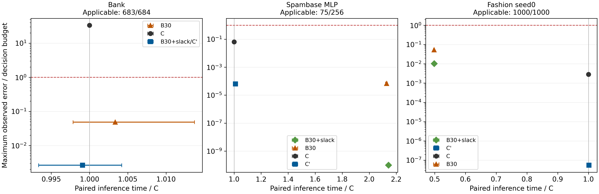

# 설정 민감도와 정밀도 여유 옵션의 제한된 실제 검증

이번 검증은 판정 조건의 적용 범위와 선택 자료의 한계, 같은 계산 구조 안의 정밀도 여유가 주는 보강 효과를 확인했다. Bank의 잠금 후 예약 감사에서는 C의 적용 영역 판정 불일치8회가 C′에서0회로 줄었지만 B30도0회였다. Spambase MLP와 Fashion에서는 C도 판정이 유지되어 C′의 효과는 수치 여유 개선에 한정됐다. 작은 N의 효율과 큰 N의 비용 손해는 모델에 따라 함께 관측됐다. 기존 A/B의 판정 개선 미관측을 이번 비용 차이로 대체하지 않는다.

## 1. 범위와 실행 단위

표에서 S는 기본 스케일의 log₂ 값이며 log₂N은 환 차수의 지수다. Q/P 개수와 비트 합은 다른 값이다.

새 protocol은 `FG_THESIS_V1_20260908`, run은 `results/fg_thesis_v1_20260908_run01`이다. A2 18, A3 18, B 24개의 고정 선택 작업을 모두 시도했다. B는 세 모델×네 방법×두 선택 키 블록이며 네 번째 방법은 독립 B30+slack 보조군이다. 정적 C/C′ 비교는 기존7모델과 Bank에서 수행했다. 새 학습 모델은0개다. 실제 새 선택·감사는 기존5모델을 재사용한다. 원래 일곱 모델 전체의 A/B/C 비교를 반복한 것이 아니다.

기록된 실험 native 호출의 누적 경과시간은 2.727시간으로 사전 상한24시간 이내다. 이는 CPU 시간 합이나 서비스 시간 아닌 외부 프로세스의 경과시간 합이다. 연결 검사와 자료 크기 probe, 정적 계획·자료 준비의 native 호출도 포함한다. 실행기의 charged_native 소계가 제외했던 정적34호출의2.786초도 최종 합계와 상한 대조에 더했다. 원래 실행 기록은 고치지 않았다. peak RSS의 관측 최대는 1711.6MiB였다. 한 번에 암호화 실험 프로세스 하나를 실행했고, 주소 공간8GiB·Go메모리 목표6GiB·여유 메모리2GiB·여유 디스크8GiB·새 자료8GiB 한도를 사용했다. `PROCESS_COSTS.csv`에는 종료코드, 실행 순서, 환경 부하와 불리한 측정도 남겼다. 문서·집계 작업과 한 차례 자료 크기 probe 빌드를 선택 실행과 병행한 이력은 `CONCURRENT_WORK_NOTE.json`에 있다. 다른 응용도 실행 중인 단일 VM이므로 독점 환경의 벤치마크라고 표현하지 않는다.

선택 시도 60건 중 선택 59건, 적용 입력 없음 1건이다. 실제 암호화 후보 평가는 74회이며 원시 후보 상태는 {'REJECTED': 15, 'SAFE': 59}다. 이 후보 상태를 입력 사건 수나 실행 프로세스 실패 수로 합치지 않는다.

감사 자체는99개 새 키 문맥과29,196 구성–입력–키 관측이다. 방법·구성·키를 합친 일반 감사의 고유 사례–입력은2,484개, 원본 고유 입력은2,228개다. 여기서 고유 입력은 원본 행 ID 단위이며 수치적으로 서로 다른 특징 벡터 수를 뜻하지 않는다. 노출 합성16개는 이 분모에서 분리했다. 선택 후보의222키 기록과 감사99키 기록은 총321개 원시 파일로 연결되며 독립 모집단 표본321개를 뜻하지 않는다. 연결 smoke 검사의2입력·3키·6관측은 `CONNECTION_CHECK_INDEX.json`으로 분리했다.

## 2. 실제 구현과 보존

공통 후보 생성·수용·조정·보안 코드는 기존 복사본과 일치한다(`CORE_RULE_EQUIVALENCE.json`). 변경은 격리한 모듈의 명령 연결과 `thesis_variant.go`에 한정한다. C′는 기존 비활성 정밀도 여유 함수를 첫 암호화 평가 전에 호출한다. 기존 정책의 scale 비트 상한50을 유지하며 같은 N 안의 모든 가능한 파라미터에 대한 최적성을 주장하지 않는다. C 경로는 기본 정책을 사용하며 상한4·세 키·첫 수용 종료·실패 후 조정을 유지했다. C′는 비교 구조 검증을 위해 기본 합성을 한 번 추가로 호출하며 이 정적 비용도 C′의 실제 선택 시간에 들어 있다. 기존 함수의 비활성화 이유는 미기록 상태다.

B30+slack은 독립 facts만 전달받는 별도 보조 규칙이다. C의 WorkloadContract나 마진 예산을 생성기에 전달하지 않는다. 기존 B30의 출발30/+4 순서는 유지하며 각 후보에서 같은 N/Q/P개수/경로/요구레벨 안에서 scale을1씩 증가시키는 정적 보조 검토를 한다. C 전용 함수와 동일한 구현이라고 부르지 않는다. 동일 literal은 감사 별칭으로 합쳤다.

`METHOD_SOURCE_MAP.csv`가 실제 함수·행·소스 해시를 연결한다. 새 후보의 실제 Q/P 소수와 분포·보안 수용은 `SECURITY_PARAMETERS.csv`와 각 `concrete_*.json`에 있다. 예를 들어 Bank C′의 선언 QP 합은210비트이지만 실제 소수 곱의 올림 log₂ 값은211비트로, 기존214비트 한도와 별도로 대조했다. static 후보 카운터, 생성 호출, 실제 암호화 후보 평가, 키 문맥과 입력–키 관측을 구별했다. 기존 정적 카운터만으로 모든 내부 시도 총수를 안다고 주장하지 않는다. `INITIAL_ANALYSIS.csv`에 오차 예산·민감도·초기 비트·백엔드 상승·여유 비트와 카운터의 범위를 기록했다.

실제 인코딩·암호화·동형연산·복호화를 실행했으나 클라이언트와 서버 역할은 같은 프로세스가 수행한 로컬 벤치마크다. 분리된 네트워크 배포나 운영 중 평문 oracle gate의 구현을 주장하지 않는다.

새 투고본은 `/home/ckks2/Downloads/(투고용)평문·암호화_추론_간_판정_일관성을_보장하는_CKKS_실행_구성_선택_기법.pdf`이며 SHA-256은 `f2675dc8de40ac6ba03ff9723fa84565e210fa1ed220ab3352bf2e4f555d102a`이다. 실제12쪽 PDF의 방법·범위를 읽고5쪽을 렌더링하여 선택 상한, 수용과 조정 설명을 확인했다. 역사적 실행 기준0905 PDF와 완료 원고·실험은 변경하지 않았다. 투고본을 새로 교정하지 않았다.

## 3. A1: 기존 고정 출력의 재분류

`A1_SENSITIVITY.csv`는77그룹×6설정, 기존573키 파일에서462행을 만들었다. 표형4·Fashion3·Bank의 선택/일반/스트레스 자료 중 기존 선택 A30/B30/C 구성을 포함한다. 새 CKKS·재선택은0회다. native TenSEAL Bank는 원래float32와 공통float64 참조를 별도로 둔36행으로 분리했다. 참조 계산 차이를 CKKS 오차와 합치지 않는다.

고정 출력의 전체 판정 변화 수와 마진>0.01 공통 영역의 판정 변화 수는 여섯 설정에서 변하지 않았다. 기존 Spambase 선형 C 감사는 기본 적용235/256에서0판정 변화였지만, δ=0에서는256/256에 기존 경계의3판정 변화와7오차 위반 사건이 포함됐다. δ=0.01이면 적용91/256으로 줄었다. Spambase MLP는 기본75/256에서 δ=0.01의2/256으로 줄었다. Fashion 세 모델의 δ=0.01 적용 수는9,984/9,985/9,985이며 출력은 그대로다. 이는 적용 범위 변화이지 오류를 고친 실행이 아니다. ρ 변화도 허용 여유의 분류만 바꾼다.

## 4. A2: 고정 여섯 설정에서 실제 C 재선택

선택 시간은 실제 CLI 호출 경계의 경과시간으로 분석·파라미터 준비·키 생성·후보 실행·수용·결과 기록을 포함한다. 호출 전 Python의 출처 해시 확인과 일정 관리, 전체 빌드/가상환경 준비는 이 열 밖에 있다. 내부 native·분석·gate 시간은 별도 CSV에 보존하므로 이를 운영 서비스 전체 비용과 동일시하지 않는다.

| 사례 | 설정 ρ/δ | 선택 S/log₂N | 후보 평가 | 선택 프로세스 초 | 결과 |
| --- | --- | --- | --- | --- | --- |
| Spambase 선형 | 0.5/0.001 | 24/13 | 2 | 28.420 | 선택 |
| Spambase 선형 | 0.25/0.001 | 24/13 | 2 | 28.778 | 선택 |
| Spambase 선형 | 0.75/0.001 | 24/13 | 2 | 29.294 | 선택 |
| Spambase 선형 | 0.5/0 | 24/13 | 2 | 29.439 | 선택 |
| Spambase 선형 | 0.5/0.0001 | 24/13 | 2 | 29.517 | 선택 |
| Spambase 선형 | 0.5/0.01 | 24/13 | 2 | 29.168 | 선택 |
| Spambase MLP | 0.25/0.001 | 20/13 | 1 | 17.448 | 선택 |
| Spambase MLP | 0.75/0.001 | 20/13 | 1 | 17.087 | 선택 |
| Spambase MLP | 0.5/0 | 20/13 | 1 | 17.147 | 선택 |
| Spambase MLP | 0.5/0.0001 | 20/13 | 1 | 17.116 | 선택 |
| Spambase MLP | 0.5/0.01 | 미선택 | 0 | 0.010 | 적용 입력 없음 |
| Spambase MLP | 0.5/0.001 | 20/13 | 1 | 17.152 | 선택 |
| Fashion seed0 | 0.75/0.001 | 33/14 | 1 | 108.600 | 선택 |
| Fashion seed0 | 0.5/0 | 33/14 | 1 | 108.370 | 선택 |
| Fashion seed0 | 0.5/0.0001 | 33/14 | 1 | 109.018 | 선택 |
| Fashion seed0 | 0.5/0.01 | 29/13 | 1 | 55.811 | 선택 |
| Fashion seed0 | 0.5/0.001 | 33/14 | 1 | 110.253 | 선택 |
| Fashion seed0 | 0.25/0.001 | 34/14 | 1 | 110.375 | 선택 |

여섯 설정을 모두 실제로 시도했다. Spambase 선형은 모든 설정에서 첫 후보S20을 거절하고 두 번째S24/N8192를 선택했다. 새 감사의 전체 판정 불일치4회는 같은 출력에서도 δ=0의 적용256개에 모두 포함되지만 기본δ=0.001의 적용235개에서는 경계 사건이다. δ=0에서는 적용 오차 조건 위반6회도 나타났다. δ=0.0001은 적용254개에서 판정 불일치0회·오차 조건 위반2회, δ=0.01은 적용91개에서두 사건0회였다. δ를 높여 분모를 줄이는 것을 오류 수정으로 해석할 수 없다. Spambase MLP는 유효한 다섯 설정에서S20/N8192를 선택했고, δ=0.01은 선택32개의 적용 영역이 비어 암호화 후보 평가 전에 미선택됐다. 이 경우는 선택 전제 미충족이며 새 암호화 실행의 수치 실패가 아니다. Fashion은 기본·δ=0·δ=0.0001·ρ=0.75에서S33/N16384, ρ=0.25에서S34/N16384, δ=0.01에서S29/N8192를 선택했다. 마지막 설정은 선택 적용 입력을500개에서499개로 바꾸고 최소 마진과 초기 오차 예산을 높여 요구 정밀도를 낮췄다. 새 감사1000개에서 이들 구성은 기본 조건의 판정·오차 검사를 모두 통과했고 δ=0.01 자체의 적용 영역은999개였다. 이 사후 관측으로 유리한 δ나 구성을 채택하지 않았다.

공통 적용 영역은 같은 평문에서 마진>0.01로 정의하였다. 동일 literal의 감사는 공유했고 별칭 수를 독립 입력·키 수로 더하지 않았다. δ=0에서도 평문 동점은 경계다.

| 사례·설정 | S/log₂N | 전체/적용 | 전체 판정 불일치 | 적용 판정 불일치/조건 위반 | 공통 영역 입력/판정 불일치 |
| --- | --- | --- | --- | --- | --- |
| Fashion seed0 delta01 | 29/13 | 1000/999 | 0 | 0/0 | 999/0 |
| Fashion seed0 base | 33/14 | 1000/1000 | 0 | 0/0 | 999/0 |
| Fashion seed0 delta0 | 33/14 | 1000/1000 | 0 | 0/0 | 999/0 |
| Fashion seed0 delta0001 | 33/14 | 1000/1000 | 0 | 0/0 | 999/0 |
| Fashion seed0 rho075 | 33/14 | 1000/1000 | 0 | 0/0 | 999/0 |
| Fashion seed0 rho025 | 34/14 | 1000/1000 | 0 | 0/0 | 999/0 |
| Spambase 선형 base | 24/13 | 256/235 | 4 | 0/0 | 91/0 |
| Spambase 선형 delta0 | 24/13 | 256/256 | 4 | 4/6 | 91/0 |
| Spambase 선형 delta0001 | 24/13 | 256/254 | 4 | 0/2 | 91/0 |
| Spambase 선형 delta01 | 24/13 | 256/91 | 4 | 0/0 | 91/0 |
| Spambase 선형 rho025 | 24/13 | 256/235 | 4 | 0/0 | 91/0 |
| Spambase 선형 rho075 | 24/13 | 256/235 | 4 | 0/0 | 91/0 |
| Spambase MLP base | 20/13 | 256/75 | 0 | 0/0 | 2/0 |
| Spambase MLP delta0 | 20/13 | 256/256 | 0 | 0/0 | 2/0 |
| Spambase MLP delta0001 | 20/13 | 256/212 | 0 | 0/0 | 2/0 |
| Spambase MLP rho025 | 20/13 | 256/75 | 0 | 0/0 | 2/0 |
| Spambase MLP rho075 | 20/13 | 256/75 | 0 | 0/0 | 2/0 |

## 5. A3: 선택 입력 수와 상한 접두 분석

기존 개발 후보256개의 원본 행 ID를 원래 감사256개와 분리하고, 입력 ID에 대한 사전 SHA-256 정렬 세 가지에서 중첩16/64/256을 만들었다. 실패 입력 삽입, 사분위 추출, 작은 마진 우선 추출은 하지 않았다. 풀 자체는 이미 사용된 개발 자료이므로 새 미사용 모집단이 아니다. 사전 중복 검사는 원본 행 ID 수준에 머물렀다. 실행 후 모델 입력 공간을 확인하니 Spambase의 개발256행은240벡터, 감사256행은241벡터였으며10벡터가 공유되어 감사25행이 해당했다. HTRU2는 각256벡터이며 공유0이다. 따라서 Spambase A3를 완전히 미관측된 특징 벡터의 독립 검증으로 해석할 수 없다. 입력 수에 따른 선택·비용의 관측은 보존하지만 분리의 범위를 낮춰 기록한다. 발견 뒤 행을 삭제·교체하거나 재실행하지 않았다(`A3_INPUT_SEPARATION_CHECK.json`).

| 사례 | 해시 순서/행 수 | 고유 모델 입력 벡터 | 감사와 공유 벡터 | 선택 S/log₂N | 후보 평가 | 선택 프로세스 초 |
| --- | --- | --- | --- | --- | --- | --- |
| Spambase 선형 | 0/16 | 15 | 4 | 24/13 | 2 | 14.702 |
| Spambase 선형 | 0/64 | 60 | 8 | 24/13 | 2 | 57.941 |
| Spambase 선형 | 0/256 | 240 | 10 | 24/13 | 2 | 234.722 |
| Spambase 선형 | 1/16 | 15 | 2 | 24/13 | 2 | 14.962 |
| Spambase 선형 | 1/64 | 60 | 6 | 24/13 | 2 | 58.438 |
| Spambase 선형 | 1/256 | 240 | 10 | 24/13 | 2 | 235.231 |
| Spambase 선형 | 2/16 | 16 | 3 | 24/13 | 2 | 15.107 |
| Spambase 선형 | 2/64 | 62 | 5 | 24/13 | 2 | 59.593 |
| Spambase 선형 | 2/256 | 240 | 10 | 24/13 | 2 | 230.446 |
| HTRU2 MLP | 0/16 | 16 | 0 | 20/13 | 1 | 5.954 |
| HTRU2 MLP | 0/64 | 64 | 0 | 20/13 | 1 | 23.156 |
| HTRU2 MLP | 0/256 | 256 | 0 | 20/13 | 1 | 92.070 |
| HTRU2 MLP | 1/16 | 16 | 0 | 20/13 | 1 | 5.921 |
| HTRU2 MLP | 1/64 | 64 | 0 | 20/13 | 1 | 23.173 |
| HTRU2 MLP | 1/256 | 256 | 0 | 20/13 | 1 | 92.145 |
| HTRU2 MLP | 2/16 | 16 | 0 | 20/13 | 1 | 5.942 |
| HTRU2 MLP | 2/64 | 64 | 0 | 20/13 | 1 | 23.173 |
| HTRU2 MLP | 2/256 | 256 | 0 | 20/13 | 1 | 92.049 |

세 해시 순서와16/64/256행에서 Spambase 선형은 항상 두 후보를 평가하여S24/N8192, HTRU2 MLP는 항상 첫 후보S20/N8192를 선택했다. 선택 입력 수 증가가 이번 선택 구성을 개선한 관측은 없었고 선택 비용은 입력 수에 따라 증가했다. 다만 사전 분리는 원본 행 ID 수준이었다. 사후 특징 벡터 점검에서 Spambase 후보256행은240종, 감사256행은241종의 벡터였고10종을 공유하여 감사25행이 후보 풀과 겹쳤다. 작은 부분집합별 중복도 표에 남겼다. HTRU2는 양쪽 각256종이며 공유0이었다. 따라서 Spambase A3는 완전히 보지 않은 모델 입력의 독립 검증이 아니며, 행 수 증가와 고정 데이터에서의 비용 관측으로 범위를 제한한다. 이 결함을 발견한 뒤 입력을 교체하거나 재실행하지 않았다. 상한1/2/4 접두 분석은 A2+A3의36작업에서 각각20/35/35작업의 선택을 나타냈고, 하나의 빈 적용 영역은 모든 접두에서 미선택이다. 별도의 상한별 실험이나 상한4 이후의 결과가 아니다.

상한1/2/4 결과는 실제 순차 선택 궤적의 접두 구간으로 재집계했다(`PREFIX_CAP.csv`). 별도의 상한별 실행이나4이후 외삽이 아니다. 입력 추출 순서와 키 블록은 다른 단위다.

## 6. B: C/C′/B30 및 독립 보조군

새 Bank 비교는 고정20→256→2 모델의 공통 Lattigo 어댑터에서 수행했다. 원래 활성화 t²+t를 이동된 제곱으로 계산하는 기존 어댑터와 가중치를 유지하며, 모든 비교군에 같은 공통 float64 참조를 적용했다. 실수 계산식의 동등성을 원래 float32 구현과의 비트 일치라고 표현하지 않는다. 이번 공식 TenSEAL 새 실행은0회이며, 과거 공식 절차의 결과는 기존 증거와 A1 재분석으로 구별한다.

| 사례 | 방법/키 블록 | 선택 S/log₂N/Q/P개수 | 후보 평가 | 선택 프로세스 초 | 분석 ms |
| --- | --- | --- | --- | --- | --- |
| Spambase MLP | C/0 | 20/13/6/1 | 1 | 17.043 | 11.999 |
| Spambase MLP | C′/0 | 29/13/6/1 | 1 | 17.237 | 90.510 |
| Spambase MLP | B30/0 | 30/14/6/1 | 1 | 35.312 | 0.461 |
| Spambase MLP | B30+slack/0 | 50/14/6/1 | 1 | 35.906 | 0.442 |
| Fashion seed0 | C′/0 | 50/14/5/1 | 1 | 107.671 | 300.765 |
| Fashion seed0 | B30/0 | 30/13/5/1 | 1 | 53.946 | 130.198 |
| Fashion seed0 | B30+slack/0 | 32/13/5/1 | 1 | 53.896 | 135.573 |
| Fashion seed0 | C/0 | 33/14/5/1 | 1 | 107.435 | 157.884 |
| Bank | B30/0 | 30/13/5/1 | 1 | 9.679 | 3.086 |
| Bank | B30+slack/0 | 33/13/5/1 | 1 | 9.786 | 2.630 |
| Bank | C/0 | 20/13/5/1 | 1 | 9.577 | 11.272 |
| Bank | C′/0 | 33/13/5/1 | 1 | 9.706 | 147.546 |
| Spambase MLP | C/1 | 20/13/6/1 | 1 | 16.945 | 11.328 |
| Spambase MLP | B30+slack/1 | 50/14/6/1 | 1 | 35.758 | 0.480 |
| Spambase MLP | B30/1 | 30/14/6/1 | 1 | 35.216 | 0.447 |
| Spambase MLP | C′/1 | 29/13/6/1 | 1 | 17.241 | 91.380 |
| Fashion seed0 | C′/1 | 50/14/5/1 | 1 | 107.320 | 300.540 |
| Fashion seed0 | C/1 | 33/14/5/1 | 1 | 107.161 | 155.727 |
| Fashion seed0 | B30+slack/1 | 32/13/5/1 | 1 | 53.845 | 135.308 |
| Fashion seed0 | B30/1 | 30/13/5/1 | 1 | 53.788 | 133.326 |
| Bank | B30/1 | 30/13/5/1 | 1 | 9.800 | 2.584 |
| Bank | C′/1 | 33/13/5/1 | 1 | 9.738 | 106.364 |
| Bank | C/1 | 20/13/5/1 | 1 | 9.683 | 11.172 |
| Bank | B30+slack/1 | 33/13/5/1 | 1 | 9.816 | 2.656 |

세 사례·네 방법·두 선택 키 블록의24작업은 모두 첫 암호화 후보에서 수용됐다. 원래 C와 선택16/32/500개, 보안 정책, ρ/δ, 실패 후 조정을 유지했다. Bank는 C의S20에서 C′의S33으로, Spambase MLP는S20에서S29로, Fashion은S33에서S50으로 정밀도가 높아졌으며 각 C–C′ 쌍의 N·Q/P개수·경로·요구 레벨은 같았다. B30은 세 사례에서S30을 사용했고, 독립 B30+slack은 각각Bank33·Spambase50·Fashion32를 선택했다. Bank의C′와B30+slack은 전체 literal과 경로가 같아 감사·시간을 공유했다. 두 선택 키 블록에서 같은 결과가 나왔다는 사실은 모든 새 키에 대한 구성 안정성 증명이 아니다.

### 구성 고정과 예약 개봉

`SOURCE_LOCK.json`과`EXECUTION_BINDING.json` 뒤에 모든 선택을 완료하고 `FROZEN_SELECTIONS.json`을 저장했다. 평가 코드·지표·실제 선택 구성·감사 배치·키·시간 규칙을 `AUDIT_PREOPEN_LOCK.json`으로 묶은 다음에만 `RESERVATION_OPEN_STARTED.json`을 남기고 예약 자료를 읽었다. 예약684개는 원래 고정 순서의3배치×228개이며 서로 다른 선택 literal마다 배치당 새 키3개다. 이 감사는 여러 방법의 동일 고정 비교 한 번이며 후속 튜닝에 사용하지 않았다.

예약 개봉 전 NumPy2.2.6의 `repr(numpy.float64)`가 Go에서 읽을 수 없는 `np.float64(...)` 문자열을 만드는 준비 코드 결함을 확인했다. 잠긴 원래 감사 실행 코드는 변경하지 않았다. `repr(float(v))`로 숫자를 직렬화하는 동일 준비 함수 사본을 별도 해시와 `RESERVATION_FORMAT_PREOPEN_AMENDMENT.json`으로 먼저 고정한 뒤 한 번 개봉했다. 행·정규화 값·모델·구성·조건·반복은 바꾸지 않았고 암호화 실패 뒤의 재시도도 아니다. 기존 감사 실행기는 교정 경로가 만든 해시 고정 READY 입력을 그대로 사용했다.

기존 관리 기록상 미점수화684개였지만 전체 시스템 접근을 증명하는 감사 로그는 없다. 전체 원자료의 complete-case·LabelEncoder·float32 minmax·NearMiss 이력을 유지했다. 기존176개 입력과 재구성 정규화가 비트 단위로 일치하는지 확인했고 NearMiss를 다시 실행하지 않았다. 따라서 누수 없는 새 고객 모집단이라는 주장은 하지 않는다. 원래 일반32와 노출 합성16을 따로 기록했다. 합성 정답은 주장하지 않는다. 예약684개와 기존 선택·개발·일반 감사176개의 원본 행 및 정규화20차원 벡터 중복은0이며 예약 내부 벡터도684종이었다. 이 사후 확인은 전체 학습 자료나 모든 과거 후보에 대한 비노출 증명이 아니다(`BANK_INPUT_IDENTITY_CHECK.json`).

| 사례·자료 | 방법/별칭 | S/log₂N | 전체/적용/경계 입력 | 키 문맥/입력–키 | 적용 판정 불일치/조건 위반 | 경계 판정 불일치 | 최대 예산 사용률 |
| --- | --- | --- | --- | --- | --- | --- | --- |
| Fashion seed0 기존 별도 | A2/A3 C | 29/13 | 1000/1000/0 | 6/3000 | 0/0 | 0 | 0.022987 |
| Fashion seed0 기존 별도 | B30+slack | 32/13 | 1000/1000/0 | 6/3000 | 0/0 | 0 | 0.010228 |
| Fashion seed0 기존 별도 | C′ | 50/14 | 1000/1000/0 | 6/3000 | 0/0 | 0 | 0.000000 |
| Fashion seed0 기존 별도 | C | 33/14 | 1000/1000/0 | 6/3000 | 0/0 | 0 | 0.002827 |
| Fashion seed0 기존 별도 | A2/A3 C | 34/14 | 1000/1000/0 | 6/3000 | 0/0 | 0 | 0.002392 |
| Fashion seed0 기존 별도 | B30 | 30/13 | 1000/1000/0 | 6/3000 | 0/0 | 0 | 0.053419 |
| Bank 기존 별도 | B30 | 30/13 | 32/32/0 | 3/96 | 0/0 | 0 | 0.001042 |
| Bank 노출 합성16 | B30 | 30/13 | 16/16/0 | 3/48 | 0/0 | 0 | 0.013050 |
| Bank 예약684 | B30 | 30/13 | 684/683/1 | 9/2052 | 0/0 | 0 | 0.048699 |
| Bank 기존 별도 | C | 20/13 | 32/32/0 | 3/96 | 0/0 | 0 | 0.426350 |
| Bank 노출 합성16 | C | 20/13 | 16/16/0 | 3/48 | 1/8 | 0 | 20.781469 |
| Bank 예약684 | C | 20/13 | 684/683/1 | 9/2052 | 8/15 | 2 | 33.580258 |
| Bank 기존 별도 | B30+slack,C′ | 33/13 | 32/32/0 | 3/96 | 0/0 | 0 | 0.000155 |
| Bank 노출 합성16 | B30+slack,C′ | 33/13 | 16/16/0 | 3/48 | 0/0 | 0 | 0.001546 |
| Bank 예약684 | B30+slack,C′ | 33/13 | 684/683/1 | 9/2052 | 0/0 | 0 | 0.002646 |
| HTRU2 MLP 기존 별도 | A2/A3 C | 20/13 | 256/254/2 | 3/768 | 0/0 | 0 | 0.087922 |
| Spambase 선형 기존 별도 | A2/A3 C | 24/13 | 256/235/21 | 3/768 | 0/0 | 4 | 0.476831 |
| Spambase MLP 기존 별도 | B30+slack | 50/14 | 256/75/181 | 3/768 | 0/0 | 0 | 0.000000 |
| Spambase MLP 기존 별도 | B30 | 30/14 | 256/75/181 | 3/768 | 0/0 | 0 | 0.000069 |
| Spambase MLP 기존 별도 | C | 20/13 | 256/75/181 | 3/768 | 0/0 | 0 | 0.064369 |
| Spambase MLP 기존 별도 | C′ | 29/13 | 256/75/181 | 3/768 | 0/0 | 0 | 0.000063 |

Bank 예약684개 중 기본 적용683개를 입력당세 키에서 평가했다. 각 literal은3배치×3키의9문맥, 전체2052입력–키 관측이다. C는 적용 판정 불일치8회(고유5입력), 적용 오차 조건 위반15회(고유8입력)를 보였으며, 그중7회는 판정이 유지된 오차 위반이었다. 경계1입력에서는 판정 불일치2회가 있어 전체 판정 불일치는10회다. C′와B30은 적용·경계 판정 불일치와 적용 오차 조건 위반이모두0회였다. 최대 적용 예산 사용률은C33.5803, B30 0.0486988, C′0.00264564였다. 오차 충분조건이 성립했는데 판정이 바뀐 반례는 없었다. 새 노출 합성16개에서는C의 판정 불일치1회·오차 위반8회가 나왔고, 과거 동일 자료의1회·6회 결과와 별도 키 관측으로 보존했다. 원래 일반32개에서는 모든 방법의 두 사건이0회였다. Spambase MLP256개와Fashion1000개에서는 네 방법 모두 기본 적용 영역의 두 사건이0회였으며 적용 수는각75개와1000개다. 과거 최대오차 기준에 대한 사후 검사에서 Spambase/Fashion의C도 이미 통과했으므로 C′의 새 수치 기준 통과 효과를 만들지 않는다. Bank의C는 그 기준을 통과하지 못했고 B30/C′는통과했다. 예약 입력도 기존 전수 정규화·NearMiss 이력의 영향을 받으므로 독립 고객 모집단이나 새로운 위험 상한으로 일반화하지 않는다.

| 사례 | 방법 | 최대 절대오차 | RMSE | 기존 최대오차 허용값 | 해당 수치 기준 통과 | 평문 정답률 |
| --- | --- | --- | --- | --- | --- | --- |
| Fashion seed0 | B30+slack | 4.8841e-05 | 3.62605e-06 | 0.0275301 | 통과 | 88.30% |
| Fashion seed0 | C′ | 2.52847e-10 | 2.73331e-11 | 0.0275301 | 통과 | 88.30% |
| Fashion seed0 | C | 3.2446e-05 | 3.60234e-06 | 0.0275301 | 통과 | 88.30% |
| Fashion seed0 | B30 | 0.000147618 | 1.48387e-05 | 0.0275301 | 통과 | 88.30% |
| Bank | B30 | 0.000202158 | 2.73406e-05 | 0.00294439 | 통과 | 86.99% |
| Bank | C | 0.194351 | 0.0281322 | 0.00294439 | 불통과 | 86.99% |
| Bank | B30+slack,C′ | 1.82627e-05 | 3.31169e-06 | 0.00294439 | 통과 | 86.99% |
| Spambase MLP | B30+slack | 1.25899e-13 | 1.06477e-14 | 0.00024221 | 통과 | 90.62% |
| Spambase MLP | B30 | 1.21566e-07 | 1.36961e-08 | 0.00024221 | 통과 | 90.62% |
| Spambase MLP | C | 7.60449e-05 | 7.86138e-06 | 0.00024221 | 통과 | 90.62% |
| Spambase MLP | C′ | 9.94252e-08 | 8.39099e-09 | 0.00024221 | 통과 | 90.62% |

수치 기준 표는 과거 개발 자료에서 고정한 모델별 최대 절대오차 허용값을 같은 출력 단위에 적용한 사후 비교다. 이번 B/C/C′의 선택 조건을 수치 기준으로 바꾼 것이 아니다. Bank는 예약684개, 나머지는 지정한 기존 감사 전체를 쓴다. 모든 실행 키에서 수치 기준을 통과했는지와 판정 조건을 통과했는지를 분리했다. 조건 통과가 두 방법의 실제 오차 크기까지 같다는 뜻은 아니다.

오차 충분조건의 재집계와 SAFE 상태를 대조했고, 조건이 성립한 상태에서 판정이 뒤집힌 관측은 없었다. 이는 미래 입력의 위험 보장이 아니다. 실패한 프로세스와 부분 키 파일이 있으면 `FAILURES.csv`와 원시 인덱스에 보존한다.

## 7. 비용과 자료 크기

대응 시간은 동일20입력에서 예열1회 뒤6회, 세 새 키 블록으로 측정하였다. 표형은 입력별 호출이고 Fashion/Bank는20입력 배치다. 방법별 키는 파라미터에 맞게 따로 만들며 같은 arm의 반복에서 재사용한다. 추론 호출 순서를 교대하고 모든 측정을 보존했다. 준비는 기존 harness의 arm 등록 순서(C→비교군)로 수행하며 준비 순서까지 균형화했다고 주장하지 않는다. 준비 구간은 파라미터·키·실행 객체 생성으로, 일부 모델/CSV 로딩과 프로세스 관리 비용은 밖에 있다. 이를 포함한 프로세스 경과시간은 별도 실행 기록에 남겼다. 키 블록 안에서 대응 비율의 기하평균을 구하고, 세 블록을 같은 비중으로 합쳤다. 입력이나 슬롯을 독립 통계 표본으로 세지 않았다. 직접 대응쌍은 각 비교군–C이며 C′–B30을 별도의 직접 대응쌍으로 측정하지 않았다. 두 군의 상대적 효율은 각각의 C 대비 대응값과 절대 시간에서 제한적으로 해석하며, 두 비율의 몫을 새로운 독립 대응 실험으로 부르지 않는다.

| 사례 | 비교군 | 비교군/C 기하평균 | 키 블록 범위 | C/비교군 중앙값 ms | 평균 대응 차이 ms | 단위 |
| --- | --- | --- | --- | --- | --- | --- |
| Fashion seed0 | B30+slack | 0.49893 | 0.49831–0.50006 | 35333.179/17617.073 | -17691.285 | 20입력 배치 |
| Fashion seed0 | C′ | 1.00152 | 1.00063–1.00283 | 35333.481/35426.794 | 53.716 | 20입력 배치 |
| Fashion seed0 | B30 | 0.49820 | 0.49625–0.49925 | 35275.507/17624.736 | -17667.268 | 20입력 배치 |
| Bank | B30 | 1.00336 | 0.99785–1.01372 | 3148.984/3156.700 | 10.700 | 20입력 배치 |
| Bank | B30+slack;C′ | 0.99908 | 0.99335–1.00420 | 3151.289/3145.031 | -2.870 | 20입력 배치 |
| Spambase MLP | B30+slack | 2.14232 | 2.13287–2.15326 | 171.046/367.816 | 196.132 | 1입력 호출 |
| Spambase MLP | B30 | 2.12852 | 2.12120–2.13350 | 171.384/365.439 | 193.647 | 1입력 호출 |
| Spambase MLP | C′ | 1.01032 | 1.00880–1.01164 | 172.862/174.193 | 1.785 | 1입력 호출 |

| 사례 | 방법 | arm–키 블록 | 준비 ms | 인코딩·암호화 ms | HE ms | 복호화·디코딩 ms | PDF 시간 중앙값 ms | wall 잔차 ms | harness wall 중앙값 ms |
| --- | --- | --- | --- | --- | --- | --- | --- | --- | --- |
| Fashion seed0 | B30 | 3 | 26.198 | 4393.605 | 13168.606 | 49.752 | 17624.736 | 8.935 | 17634.630 |
| Fashion seed0 | B30+slack | 3 | 28.236 | 4385.600 | 13170.893 | 49.855 | 17617.073 | 8.931 | 17625.497 |
| Fashion seed0 | C | 9 | 46.296 | 9275.946 | 25959.134 | 100.699 | 35333.179 | 11.220 | 35344.999 |
| Fashion seed0 | C′ | 3 | 49.392 | 9281.771 | 26017.066 | 111.182 | 35426.794 | 14.033 | 35438.853 |
| Bank | B30 | 3 | 27.114 | 112.898 | 3027.021 | 10.395 | 3156.700 | 2.230 | 3158.042 |
| Bank | B30+slack;C′ | 3 | 27.280 | 113.467 | 3021.836 | 10.419 | 3145.031 | 2.153 | 3147.622 |
| Bank | C | 6 | 25.181 | 112.726 | 3030.140 | 8.311 | 3150.136 | 2.380 | 3152.438 |
| Spambase MLP | B30 | 3 | 62.167 | 193.406 | 146.423 | 25.550 | 365.439 | 0.005 | 365.444 |
| Spambase MLP | B30+slack | 3 | 65.371 | 193.996 | 147.167 | 26.848 | 367.816 | 0.005 | 367.821 |
| Spambase MLP | C | 9 | 34.853 | 91.362 | 69.947 | 10.659 | 171.518 | 0.004 | 171.523 |
| Spambase MLP | C′ | 3 | 36.897 | 91.706 | 70.369 | 12.546 | 174.193 | 0.004 | 174.197 |

사전 protocol의 주 지표인 PDF 시간은 기록된 인코딩·암호화+HE+복호화·디코딩의 합이다. 원시 `total_ms`는 바깥쪽 경과시간이며 다중 클래스 경로에서는 평문 참조 계산·기록 구성·명시적 GC 등이 더 포함된다. 처음 집계 코드가 두 값의 일치를 가정하여 중단됐으나 실제 호출 경계를 확인하고 주 지표를 사전 정의대로 계산했다. 원시 시간·실패 로그는 보존했으며 새 측정은 하지 않았다(`TIMING_FORMULA_CORRECTION.json`). 기록 wall과 주 지표의 양의 차이를 별도 잔차로 남겼다. 잔차 내부 원인별 시간은 각각 측정하지 않았으므로 gate나 네트워크 시간으로 단정하지 않는다. 앞선 진행 안내의 비율은 wall 미리보기였으며 최종 표의 주 비율은 사전 정의의 성분 합이다.

위 분해표는 각 arm–키 블록 평균의 중앙값이며 각 열의 중앙값 합이 PDF 시간 중앙값과 정확히 같을 필요는 없다. C 참조는 비교 쌍마다 다시 측정되므로 반복 C행 수를 새 모델 수로 세지 않는다. `TIMING_KEY_BLOCKS.csv`·`TIMING_ARMS.csv`·`TIMING_RAW.csv`가 절대값·범위·준비 비용과 대응 기록을 보존한다. 키 준비를 한 군에서만 빼지 않았다. 새 원시 harness의 과거 V17/Bank_B3 문자열은 상속된 서식이며 현재 선택 방법은 새 schedule/alias가 기준이다.

Bank에서C′/C의 사전 정의 PDF 추론 시간 비율은0.99908(키 블록0.99335–1.00420),20입력 배치의 평균 대응 차이는−2.870ms였다. N8192·Q5/P1과 연산 수가 같아 정밀도 증가가 큰 시간 차이를 만들지 않았다. 선택 프로세스는C9.58–9.68초, C′9.71–9.74초, B30 9.68–9.80초였다. 이를 동등성이나 무손해 보장이라고 부르지 않는다. Spambase MLP의C′/C는1.01032(1.00880–1.01164), 평균 대응 증가1.785ms/입력이었다. C′의 관측 증가를0으로 처리하지 않는다. C′는N8192를 유지하며 선택17.24초, 추론 중앙값174.19ms였고 B30은N16384·선택35.22–35.31초·추론 중앙값365.44ms였다. B30/C의 별도 대응 비율은2.12852였다. C′–B30의 직접 대응 실험은 아니며, 작은N의 이득은 기존C가 이미 얻었던 효과다. Fashion의C′/C는1.00152(1.00063–1.00283), 평균 대응 증가53.716ms/20입력 배치였다. C/C′의선택은약107초, B30은약54초였고 B30/C와B30+slack/C의 추론 비율은각0.49820과0.49893이었다. C′는수치 여유만 더했으며 C의N16384와약35초 배치 시간을 줄이지 못했다. 세 사례를 평균내어 무손해라고 결론 내리지 않는다. 준비와 공개키·평가키·암호문 크기, 바깥쪽 경과시간의 잔차는 별도 표로 남겼고 네트워크·대기는 미측정이다.

| 사례 | 방법 | arm–키 문맥 | 반복 적용 판정 불일치 | 반복 적용 오차 위반 |
| --- | --- | --- | --- | --- |
| Fashion seed0 | B30 | 3 | 0 | 0 |
| Fashion seed0 | B30+slack | 3 | 0 | 0 |
| Fashion seed0 | C | 9 | 0 | 0 |
| Fashion seed0 | C′ | 3 | 0 | 0 |
| Bank | B30 | 3 | 0 | 0 |
| Bank | B30+slack;C′ | 3 | 0 | 0 |
| Bank | C | 6 | 0 | 0 |
| Spambase MLP | B30 | 3 | 0 | 0 |
| Spambase MLP | B30+slack | 3 | 0 | 0 |
| Spambase MLP | C | 9 | 0 | 0 |
| Spambase MLP | C′ | 3 | 0 | 0 |

이 표는 시간 측정 중 같은 arm–키에서6회 반복한 사건이다. 주 감사의 고유 입력·새 키 분모에 더하지 않는다. 표형은 기록된 스칼라 출력에서 재계산했으며, 다중 클래스는 시간 harness가 저장한 적용 영역의 판정·오차 조건 집계값이다. 경계 입력이 있는 경우 그 판정 사건이 기록되지 않은 값을0으로 채우지 않는다. 시간 파일에 클래스별 출력이 없어 그 부분을 입력별로 독립 재구성했다고 하지 않는다.

그림의 가로축은 C 대비 대응 추론 시간 비율이고, 세로축은 기본 적용 영역(ρ=0.5, δ=0.001)에서의 최대 오차 예산 사용률이다. 패널의 수는 적용/전체 입력 수다. 가로선은 세 키 블록 비율의 관측 범위로 신뢰구간이 아니다. C의 가로축1은 정규화 기준이며 시간 변동이0이라는 뜻이 아니다. 동일 literal의 방법은 하나의 점으로 표시했다.

`MATERIAL_SIZES.csv`는 새 공개키·재선형화키와 degree1 암호문을 실제 생성·직렬화하여 얻은 크기다. 비밀키는 직렬화하거나 저장하지 않았다. 입력값0인 별도 자료 크기 probe로 레벨별 한 암호문 크기를 측정하고 실제 추론의 암호문 수·초기/최종 레벨로 합계 크기를 산출했다. 출력 암호문의 scale 등 메타데이터까지 probe와 비트 단위로 같은지 확인한 값은 아니며, 실제 추론 암호문 전체를 직렬화·전송한 측정과 구별한다. 이번 대표 모델은 회전키0개이며 기존 회전 경로 전체의 크기 결과가 아니다. 측정하지 않은 네트워크와 큐 대기는0이 아닌 미측정이다. 추론 중 adapter I/O의 기록상0은 네트워크0을 뜻하지 않는다.

| 사례 | 방법 | 배치 유효 입력 | 입력/출력 암호문 수 | 입력 산출 MiB | 출력 산출 MiB | 공개키 MiB | 재선형화키 MiB |
| --- | --- | --- | --- | --- | --- | --- | --- |
| Fashion seed0 | B30+slack | 500 | 784/10 | 490.286 | 2.503 | 0.750 | 3.751 |
| Fashion seed0 | C′ | 500 | 784/10 | 980.286 | 5.003 | 1.500 | 7.501 |
| Fashion seed0 | C | 500 | 784/10 | 980.286 | 5.003 | 1.500 | 7.501 |
| Fashion seed0 | B30 | 500 | 784/10 | 490.286 | 2.503 | 0.750 | 3.751 |
| Bank | B30 | 228 | 20/2 | 12.507 | 0.501 | 0.750 | 3.751 |
| Bank | C | 228 | 20/2 | 12.507 | 0.501 | 0.750 | 3.751 |
| Bank | B30+slack,C′ | 228 | 20/2 | 12.507 | 0.501 | 0.750 | 3.751 |
| Spambase MLP | B30+slack | 1 | 16/1 | 24.006 | 0.750 | 1.750 | 10.501 |
| Spambase MLP | B30 | 1 | 16/1 | 24.006 | 0.750 | 1.750 | 10.501 |
| Spambase MLP | C | 1 | 16/1 | 12.006 | 0.375 | 0.875 | 5.251 |
| Spambase MLP | C′ | 1 | 16/1 | 12.006 | 0.375 | 0.875 | 5.251 |

크기 표는 감사의 실제 배치 크기를 표시하며, 앞의 시간 비교는20입력 기준이다. 크기 probe의 단일 관측을 크기 변동의 통계 검증으로 표현하지 않는다.

## 8. 응용과 환경의 미실시 범위

공식 UNSW 자료 설명과 공유 링크를 확인했으나 특징 CSV를 확보하지 못했다. 익명 공유 페이지는 파일 목록 없는 응용 화면이었고 공식 API는403 accessDenied였다. 지시문5절에 따라 IDS 부분을 보류했다. 새 IDS 학습·암호화 실험은각0이며 Kaggle 대체본, PCAP 처리나 추가 데이터셋을 사용하지 않았다. 실행 가능한 A/B 작업은 계속했다. 별도 물리 장비는 제공되지 않아 독립 환경 검증도 미실시다. 같은 VM의 반복을 별도 장비 검증으로 부르지 않는다. `DEFERRED_EXECUTION_BUNDLE.json`에 한정된 다음 실행 규격과 필요한 연결을 남겼으며 자동 실행하지 않는다. 회전 경로의 기존 모델·선택250·감사250 사본은 원본을 실행하지 않고 관리 해시와 일치하는217,863바이트만 준비했다. 기존 표형·Fashion 의존성은 이미 protocol과 소스 잠금에 연결된다. 회전 경로가 요구하는 MNIST 원자료와 추출 manifest, 새 장비·명령 연결은 아직 검증되지 않았으므로 이 준비 자료를 자족적인 실행 환경이나 독립 장비 재현 완료라고 부르지 않는다(`INDEPENDENT_DEVICE_PREPARATION.json`).

## 9. 검증과 종료

설정·선택 자료에 따른 범위, 기존 독립 대조군의 무차이, Bank 실패와 C′의 보강, 모델별 비용의 이득·손해를 근거에 연결하였다. 실행 가능한 A1/A2/A3/B와 사전 지정 감사·대응 시간·자료 크기 확인은 완료했다. IDS는 공식 특징CSV 접근 차단, 독립 물리 환경은 장비 미제공으로 미실시이므로 응용·다른 장비에 대한 주장을 확대하지 않는다. Spambase A3의 모델 입력 중복도 평가 분리의 한계로 명시했다. 지시문9절의 범위 축소 조건에 따라 이번 유한 묶음을 종료하고 석사학위논문 본격 집필로 전환할 수 있다. 이는 모든 실증 항목의 성공이나 학위 심사 통과, 강한 국제적 신규성의 판정이 아니다.

단위·엄격한 부등호·동점 경계·모든 경쟁 클래스·별칭·실행 실패를 점검했다. 완료 후 읽기 전용 재검증 명령은 `/home/ckks2/deciprotect`에서 `PYTHONDONTWRITEBYTECODE=1 python3 results/fg_thesis_v1_20260908_run01/scripts/verify_final.py --check-only`이다. 원시 키 파일321개와 대응 시간 파일24개의 해시도 재대조하며 새 암호화 실행이나 결과 덮어쓰기를 하지 않는다. 코드 테스트 통과는 성능 개선이나 위험 보장이 아니다. `NEW_METRICS_VERIFIED.json`, `TIMING_VERIFIED.json`, `FINAL_VERIFICATION.json`과 ZIP manifest가 검증 근거다. 사용자 변경을 reset하지 않았고 원격 push·업로드·archive 전송·전수 재해시를 하지 않았다.
